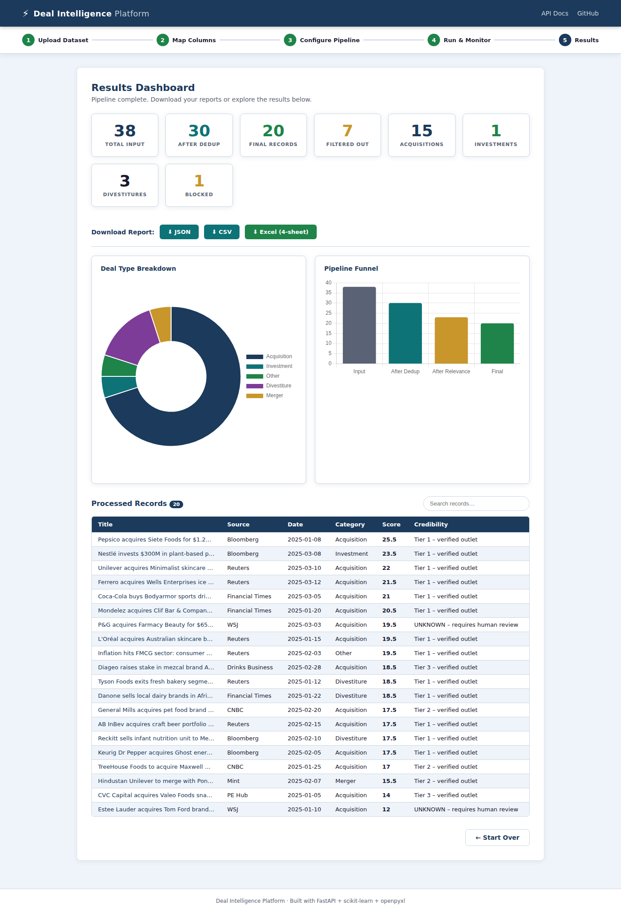
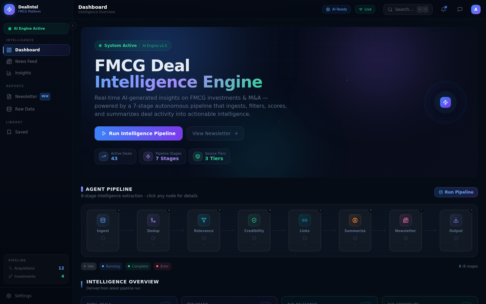
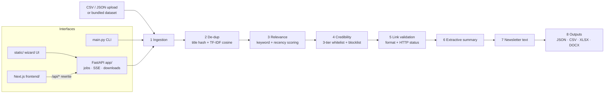

# FMCG Deal Intelligence Newsletter

**Turns a noisy feed of deal news into a ranked, de-duplicated, source-checked FMCG M&A newsletter — exported as JSON, CSV, Excel and Word.**

[](https://github.com/Akshatb848/FMCG-deal-intelligence-newsletter/actions/workflows/ci.yml)
[](LICENSE)




<sub>Screenshot of the built-in web UI (`static/`) after uploading `data/raw_articles.csv` and running the FMCG preset — captured headlessly with Playwright from a local run. 38 input articles → 30 after de-duplication → 20 in the final newsletter.</sub>

---

## What it does

An 8-stage, deterministic Python pipeline (no LLM, no paid APIs) that takes a CSV/JSON of news articles and:

1. **Ingests** and normalises records (configurable column mapping, ISO dates).
2. **De-duplicates** — exact title-hash dedup + near-duplicate detection with TF-IDF (bigrams) cosine similarity (threshold 0.20), keeping the version from the most credible source.
3. **Scores relevance** — keyword scoring for sector terms (0–40) and deal vocabulary (0–40), a recency bonus (0–10), and detects the deal type (Acquisition, Investment, Divestiture, Merger, …).
4. **Checks credibility** — 3-tier source whitelist (Reuters/Bloomberg/FT/WSJ → tier 1, etc.) and a hard blocklist for rumour sites.
5. **Validates links** — URL format, placeholder/blocked domains, and a concurrent HTTP status check.
6. **Summarises** — extractive (sentence scoring), plus regex extraction of the deal value and keyword-based company tagging.
7. **Generates the newsletter** — top-3 highlights, all deals grouped by type, template-based trend insights.
8. **Exports** — `processed_articles.json`, `processed_articles.csv`, a 4-sheet Excel report (newsletter, deal summary + bar chart, all articles, pipeline log) and a Word newsletter.

Everything is driven by a `PipelineConfig` dataclass, so the same pipeline can be pointed at another domain (the web UI ships an FMCG preset and a Tech M&A preset).

## Key features

- **CLI** for batch runs and **FastAPI** backend with async jobs, Server-Sent-Events progress streaming, upload and download endpoints (`/docs` for OpenAPI).
- **Two front ends:** a zero-build wizard UI served by FastAPI (`static/`), and a Next.js 14 dashboard (`frontend/`) that proxies `/api/*` to the backend.
- **Explainable scoring:** every article carries its sub-scores, credibility tier/flag, dedup method and link-check note.
- **Synthetic data generator:** `data/generate_fmcg_dataset.py` (seeded, `random.seed(42)`) produces a 563-row dataset with planted exact duplicates, near-duplicates, off-topic noise and broken URLs.

<details>
<summary>Next.js dashboard (frontend/) connected to the local backend</summary>



<sub>Captured from `next start` with the FastAPI backend running locally after `POST /api/run-pipeline` on the 563-row synthetic dataset (43 deals in the final output). Labels such as "AI Engine" are UI copy — the underlying logic is rule-based, and the chat assistant in this UI answers from templates in `frontend/lib/api.ts`, not an LLM.</sub>
</details>

## Architecture



| Layer | Location |
|-------|----------|
| Pipeline stages | `pipeline/` (`ingestion`, `dedup`, `relevance`, `credibility`, `link_validator`, `summarization`, `newsletter_text`, `newsletter`, `runner`, `config`) |
| Web API | `app/server.py`, `app/routes/` (upload, jobs + SSE stream, results, pipeline) |
| In-memory job store | `app/job_store.py` |
| Wizard UI | `static/` (vanilla JS + Chart.js) |
| Dashboard UI | `frontend/` (Next.js 14, TypeScript, Tailwind, React Query, Zustand, Recharts) |

## Tech stack

Python 3.11 · FastAPI · Uvicorn · scikit-learn (TF-IDF, cosine similarity) · pandas · openpyxl · python-docx · requests · Next.js 14 / React 18 / TypeScript / Tailwind CSS · pytest · GitHub Actions

## Quick start

```bash
git clone https://github.com/Akshatb848/FMCG-deal-intelligence-newsletter.git
cd FMCG-deal-intelligence-newsletter
python -m venv .venv && source .venv/bin/activate
pip install -r requirements.txt

# CLI: run the pipeline on the 38-article sample
python main.py --data data/raw_articles.csv --output output/

# Web app (API + wizard UI) on http://localhost:8000  (API docs at /docs)
python main.py            # or: python main.py serve --port 8000
```

Next.js dashboard (optional, needs the backend running on port 8000):

```bash
cd frontend
npm ci
npm run dev               # http://localhost:3000
```

Regenerate the synthetic dataset: `python data/generate_fmcg_dataset.py`.

Deployment config is included for Railway (`railway.toml`, `Procfile`) and Vercel (`frontend/vercel.json`). There is no Dockerfile.

### Environment variables

No secrets are needed. See [`.env.example`](.env.example):

| Variable | Used by | Default |
|----------|---------|---------|
| `PORT` | `main.py` (FastAPI server) | `8000` |
| `NEXT_PUBLIC_API_URL` | `frontend/next.config.js` (backend for `/api/*` rewrites) | `http://localhost:8000` |

## Sample run (bundled 38-article dataset)

Reproduced by `tests/test_pipeline.py` with HTTP link checks disabled:

```
[Ingestion]     Loaded 38 records
[De-dup]        38 → 30   (8 near-duplicate removals)
[Relevance]     30 → 24   (6 below relevance threshold of 8.0)
[Credibility]   24 → 23   (1 hard-blocked from unreliable sources)
[LinkValidator] 23 → 20   (3 URLs not reachable / not whitelisted)
Final: 20 records → JSON, CSV, XLSX, DOCX
Category breakdown: 13 Acquisition · 4 Divestiture · 1 Investment · 1 Merger · 1 Other
```

On the 563-row synthetic dataset (`data/fmcg_deals_500.csv`): 563 → 57 after de-dup (155 exact + 351 near) → 43 after relevance → 43 final.

## Testing

```bash
pip install -r requirements-dev.txt
pytest -q
```

The suite (`tests/`) covers ingestion, exact de-duplication, URL validation rules, an end-to-end run on the sample data asserting the stage-by-stage funnel and all four output files, and API smoke tests (health, index page, download validation). Tests run offline: HTTP link checks are disabled and the raw-data side file is redirected to a temp dir.

CI (`.github/workflows/ci.yml`) runs on every push/PR: ruff (syntax/undefined-name checks), pytest, a CLI smoke run, and a Next.js type-check + production build.

## Project structure

```
├── main.py                 # CLI + server entry point
├── pipeline/               # the 8 pipeline stages + PipelineConfig
├── app/                    # FastAPI app, routes, in-memory job store
├── static/                 # wizard UI served by FastAPI
├── frontend/               # Next.js 14 dashboard
├── data/                   # sample + synthetic datasets, dataset generator
├── output/                 # example outputs from a previous run (JSON/CSV/XLSX/DOCX)
├── tests/                  # pytest suite
└── docs/screenshots/       # README images
```

## Limitations & roadmap

Candidly:

- **Synthetic / sample data only.** `data/raw_articles.csv` is a hand-made sample and `data/fmcg_deals_500.csv` is generated by a seeded script; there is no live news ingestion yet (NewsAPI/RSS would plug into `pipeline/ingestion.py`).
- **Rule-based, no LLM or trained model.** Relevance is keyword scoring, summaries are extractive, insights are template sentences. Interpretable, but it will miss deals phrased with vocabulary outside the keyword lists.
- **TF-IDF threshold (0.20) is calibrated on the sample data** and may need re-tuning on a larger real corpus; embeddings would generalise better.
- **Link validation hits the network**, so the final count can vary with connectivity; trusted domains are kept as "unverified" when the network is unavailable.
- **Credibility = outlet reputation**, not article accuracy.
- **Job store is in-memory** — jobs are lost on restart (only the latest results are persisted to `data/latest_results.json`). No auth on the API.
- `frontend/` pins `next@14.2.5`, which npm flags with a security advisory; upgrading to a patched 14.2.x is recommended.

Roadmap ideas: live news connectors, sentence-embedding dedup, ML relevance classifier, persistent job store, email delivery.

## License

[MIT](LICENSE) © 2026 Akshat Banga

## Author

**Akshat Banga** — [github.com/Akshatb848](https://github.com/Akshatb848)
